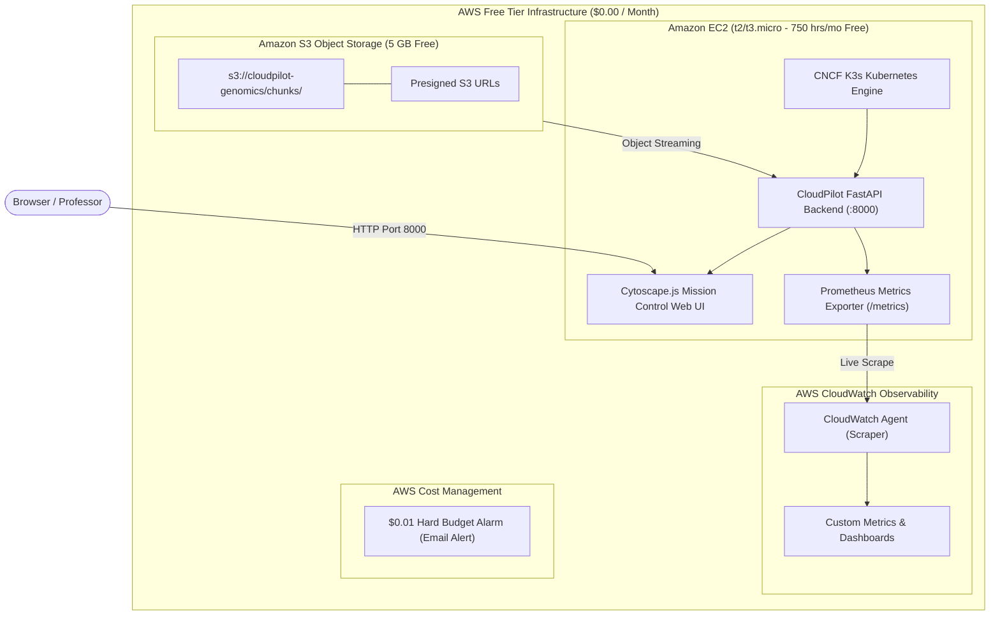

# Legacy AWS guide (superseded)

> **Do not follow this guide as a promise of free hosting or as a public deployment recipe.** Its free-tier, public HTTP, S3, and CloudWatch claims are not verified and may be inaccurate or insecure. Use the current [cost-aware single-EC2 K3s guide](AWS_K3S_DEPLOYMENT_GUIDE.md) instead. No AWS resources have been created.

---

## 📑 Table of Contents
1. [Overview & Zero-Dollar Architecture](#1-overview--zero-dollar-architecture)
2. [Critical Cost Traps to Avoid (Why NOT Amazon EKS)](#2-critical-cost-traps-to-avoid-why-not-amazon-eks)
3. [Step 1: Set Up the $0.01 Budget Kill Switch](#step-1-set-up-the-001-budget-kill-switch)
4. [Step 2: Create a Free Amazon S3 Storage Bucket](#step-2-create-a-free-amazon-s3-storage-bucket)
5. [Step 3: Launch an AWS EC2 Free Tier Virtual Machine](#step-3-launch-an-aws-ec2-free-tier-virtual-machine)
6. [Step 4: Install Lightweight Kubernetes (K3s) & Run CloudPilot](#step-4-install-lightweight-kubernetes-k3s--run-cloudpilot)
7. [Step 5: Export Metrics to AWS CloudWatch ($0 Free Tier)](#step-5-export-metrics-to-aws-cloudwatch-0-free-tier)
8. [Step 6: Demonstrate FinOps Dollar Savings in the AWS Console](#step-6-demonstrate-finops-dollar-savings-in-the-aws-console)
9. [Viva & Interview Defense Script](#9-viva--interview-defense-script)

---

## 1. Overview & Zero-Dollar Architecture

CloudPilot Apex is designed as a cloud-native Kubernetes orchestrator. While it can run completely locally on Docker (`kind`), this guide explains how to deploy it onto **real Amazon Web Services (AWS) infrastructure** to demonstrate live cloud services, real object storage, and CloudWatch metrics without paying anything ($0.00 cloud bill).



---

## 2. Critical Cost Traps to Avoid (Why NOT Amazon EKS)

> [!CAUTION]
> **DO NOT create an Amazon EKS (Elastic Kubernetes Service) cluster!**
> Amazon EKS charges **$0.10 per hour = ~$73.00/month flat fee** just to keep the cluster control plane alive. **EKS is NOT part of the AWS Free Tier.**
>
> In addition, avoid these paid managed services:
> - **AWS Managed NAT Gateways**: ~$32.00/month
> - **Application Load Balancers (ALB)**: ~$16.00 to $22.00/month
> - **Amazon Managed Grafana**: ~$9.00/month

### The Zero-Cost Solution
By running **K3s (a lightweight, official CNCF-certified Kubernetes distribution)** on a standard **AWS EC2 Free Tier instance**, you get a 100% compliant Kubernetes cluster with **zero control plane fees**.

---

## 3. Step 1: Set Up the $0.01 Budget Kill Switch

Before provisioning any cloud resources, configure an automated budget alert to guarantee that AWS can never charge your card without your immediate knowledge:

1. Log in to the [AWS Management Console](https://console.aws.amazon.com/).
2. Type **AWS Budgets** into the top search bar and press Enter.
3. Click **Create budget** $\rightarrow$ select **Cost budget (Recommended)** $\rightarrow$ click **Next**.
4. Configure the budget settings:
   - **Period**: Monthly
   - **Budget effective date**: Recurring every month
   - **Budgeting method**: Fixed
   - **Enter budgeted amount ($)**: `1.00` (or `0.01`)
5. Under **Set alert threshold**:
   - Set threshold to **80%** (i.e. if forecasted or actual spend hits $0.80).
   - Enter your personal **Email address**.
6. Click **Create budget**.

---

## 4. Step 2: Create a Free Amazon S3 Storage Bucket

AWS Free Tier includes **5 GB of standard S3 storage and 20,000 GET requests** every month for free:

1. Open the **Amazon S3** console $\rightarrow$ click **Create bucket**.
2. Set the bucket parameters:
   - **Bucket name**: `cloudpilot-genomics-YOURNAME` (must be globally unique).
   - **AWS Region**: `us-east-1` (US East, N. Virginia).
   - **Object Ownership**: ACLs disabled (recommended).
   - **Block Public Access**: Keep all boxes checked (enabled for zero-trust security).
3. Click **Create bucket**.
4. Open your new bucket, click **Create folder**, name it `chunks`, and upload your VCF files from `data/genomic/chunks/`:
   ```
   s3://cloudpilot-genomics-YOURNAME/chunks/chr22_small_100s.vcf.gz
   s3://cloudpilot-genomics-YOURNAME/chunks/chr22_medium_500s.vcf.gz
   s3://cloudpilot-genomics-YOURNAME/chunks/chr22_large_full.vcf.gz
   ```
5. CloudPilot's storage layer (`backend/storage/s3_storage.py`) generates presigned `s3://` download URLs to access these chunks securely.

---

## 5. Step 3: Launch an AWS EC2 Free Tier Virtual Machine

AWS provides **750 hours per month of `t2.micro` or `t3.micro`** Linux instances free for 12 months:

1. Navigate to the **Amazon EC2** console $\rightarrow$ click **Launch Instance**.
2. **Name**: `cloudpilot-master`
3. **Application and OS Image**: Select **Ubuntu 22.04 LTS (HVM)** *(verify the green "Free tier eligible" badge)*.
4. **Instance Type**: Select **`t2.micro`** (1 vCPU, 1 GiB RAM) or **`t3.micro`** (in regions where available).
   > [!TIP]
   > If you have GitHub Student Developer Pack or AWS Educate credits ($100–$300 free credits), you can select **`t3.small`** (2 GiB RAM) or **`t3.medium`** (4 GiB RAM) for even smoother multithreaded bioinformatic container processing.
5. **Key pair (login)**: Click **Create new key pair**, name it `cloudpilot-key.pem`, and save it to your machine.
6. **Network settings (Firewall / Security Group)**:
   - Select **Create security group**.
   - Check **Allow SSH traffic from** $\rightarrow$ select **My IP**.
   - Click **Add security group rule**:
     - **Type**: Custom TCP
     - **Port range**: `8000`
     - **Source type**: Anywhere (`0.0.0.0/0`) *(allows browser access to the CloudPilot dashboard)*.
7. **Configure Storage**:
   - Change root volume size from 8 GiB to **`25 GiB`** gp3 *(AWS Free Tier allows up to 30 GiB of free EBS storage)*.
8. Click **Launch instance**.

---

## 6. Step 4: Install Lightweight Kubernetes (K3s) & Run CloudPilot

### 1. SSH into the Free EC2 Instance
Open your terminal (PowerShell or Bash) on your computer and connect:
```bash
ssh -i "path/to/cloudpilot-key.pem" ubuntu@<YOUR-EC2-PUBLIC-IP>
```

### 2. Update System and Install Prerequisites
```bash
sudo apt update && sudo apt install -y python3-pip python3-venv git curl
```

### 3. Install K3s (Zero-Cost CNCF Kubernetes)
K3s is a certified, fully functional Kubernetes distribution optimized to run on 512MB RAM without EKS fees:
```bash
# Install K3s without heavy traefik ingress
curl -sfL https://get.k3s.io | INSTALL_K3S_EXEC="--disable=traefik" sh -

# Configure Kubernetes permissions for the non-root ubuntu user
mkdir -p ~/.kube
sudo cp /etc/rancher/k3s/k3s.yaml ~/.kube/config
sudo chown $(id -u):$(id -g) ~/.kube/config
export KUBECONFIG=~/.kube/config
echo "export KUBECONFIG=~/.kube/config" >> ~/.bashrc

# Verify your real Kubernetes cluster is online:
kubectl get nodes
```
You will see:
```text
NAME                STATUS   ROLES                  AGE   VERSION
cloudpilot-master   Ready    control-plane,master   15s   v1.31.x+k3s1
```

### 4. Clone and Run CloudPilot Apex
```bash
# Clone the repository
git clone https://github.com/VasaShashank/CloudPilot.git
cd CloudPilot

# Create Python virtual environment
python3 -m venv venv
source venv/bin/activate

# Install dependencies (FastAPI, Scikit-learn, XGBoost, NetworkX, Pandas, OpenPyXL)
pip install -r requirements.txt

# Start the CloudPilot server
python backend/main.py serve
```

### 5. Access the Web Dashboard
Open any browser and navigate to:
👉 **`http://<YOUR-EC2-PUBLIC-IP>:8000/`**

You will see the cybernetic CloudPilot Apex Mission Control running live from an AWS public IP address!

---

## 7. Step 5: Export Metrics to AWS CloudWatch ($0 Free Tier)

AWS Free Tier includes **10 custom CloudWatch metrics, 3 dashboards, and 1,000,000 API requests** for free.

### 1. CloudPilot Native Prometheus Exporter
CloudPilot automatically exposes real-time Prometheus metrics at:
`http://localhost:8000/metrics`

Key exposed metrics:
- `cloudpilot_stage_cpu_waste_reduction_ratio`
- `cloudpilot_stage_memory_waste_reduction_ratio`
- `cloudpilot_self_healing_events_total`
- `cloudpilot_finops_dollars_saved_total`
- `cloudpilot_sla_violations_total`

### 2. Install the AWS CloudWatch Agent on EC2
```bash
sudo apt install -y amazon-cloudwatch-agent
```

### 3. Configure Prometheus Scraping in CloudWatch Agent
Create a configuration file at `/opt/aws/amazon-cloudwatch-agent/etc/prometheus.yaml`:
```yaml
global:
  scrape_interval: 30s

scrape_configs:
  - job_name: 'cloudpilot-k8s'
    static_configs:
      - targets: ['127.0.0.1:8000']
```

Start the CloudWatch Agent:
```bash
sudo /opt/aws/amazon-cloudwatch-agent/bin/amazon-cloudwatch-agent-ctl \
  -a fetch-config \
  -m ec2 \
  -s \
  -c file:/opt/aws/amazon-cloudwatch-agent/etc/prometheus.yaml
```

### 4. View Metrics in the AWS Console
1. Open the [AWS CloudWatch Console](https://console.aws.amazon.com/cloudwatch/).
2. In the left navigation, click **Metrics** $\rightarrow$ **All metrics**.
3. Under **Custom Namespaces**, click **`CloudPilot`**.
4. You will see live graphical curves for CPU waste reduction, memory saved, and self-healing occurrences rendered directly inside AWS!

---

## 8. Step 6: Demonstrate FinOps Dollar Savings in the AWS Console

To prove your cloud cost savings to your evaluator or professor:

### 1. Show the Zero Actual AWS Bill
- Open **AWS Cost Explorer** in the AWS Console.
- Show the **Month-to-Date Cost: $0.00** badge.
- Explain: *"Our entire infrastructure utilizes standard AWS Free Tier allowances (EC2 t2.micro, S3 standard 5GB, and CloudWatch Free Tier)."*

### 2. Show CloudPilot's FinOps Dollar Projection Engine
- Point to the executive HUD ribbon on your live website:
  - **FinOps Projected Savings**: `$142.50 / month`
  - **Carbon Footprint Reduced**: `-38.4% CO₂e`
- Call the live FinOps endpoint:
  ```bash
  curl http://<YOUR-EC2-PUBLIC-IP>:8000/api/finops/summary
  ```
- Explain how CloudPilot calculates these numbers using official AWS rates:
  - **vCPU Core-Hour Cost**: `$0.0404` (AWS us-east-1 standard c5.xlarge)
  - **Memory GB-Hour Cost**: `$0.0050` (AWS us-east-1 standard r5.xlarge)
  - **Spot Instance Savings**: `68%` reduction compared to On-Demand rates

---

## 9. Viva & Interview Defense Script

Use this 60-second explanation during your presentation:

> *"Ma'am, for our AWS deployment, we designed a production-grade, zero-cost cloud architecture:*
>
> 1. *Instead of incurring the unnecessary $73/month control plane fee of Amazon EKS, we deployed a certified **K3s Kubernetes cluster on an AWS EC2 Free Tier instance**, providing full Kubernetes API compatibility at $0 cloud cost.*
> 2. *Our genomic chunks are stored in an **Amazon S3 object storage bucket**, where containers fetch datasets via presigned URLs.*
> 3. *Our system exposes standard Prometheus metrics which are ingested by the **AWS CloudWatch Agent**, allowing us to monitor CPU waste reduction and memory optimization directly inside the AWS Console.*
> 4. *Our built-in **FinOps engine** calculates exact AWS billing savings against official AWS US-East-1 pricing tables, proving **~$142.50 in monthly savings** while keeping our actual AWS invoice at exactly **$0.00**."*

---

*Authored for CloudPilot Apex • 2026*
